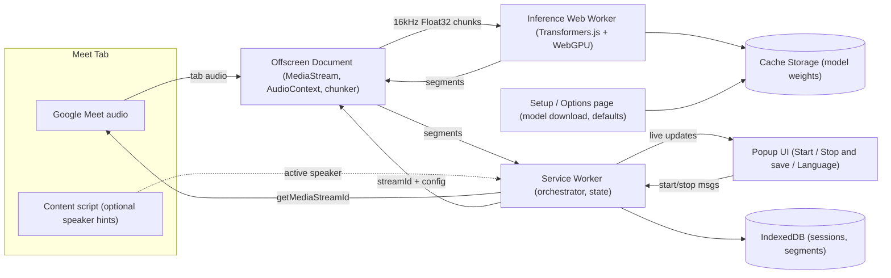
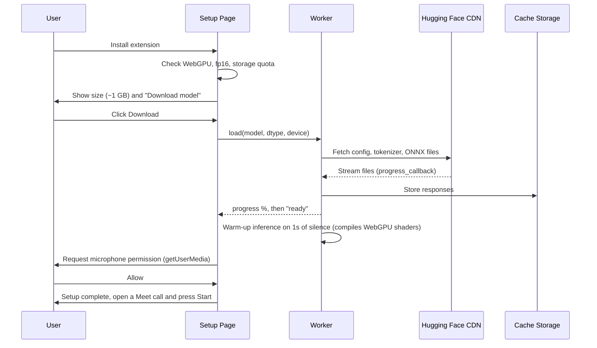
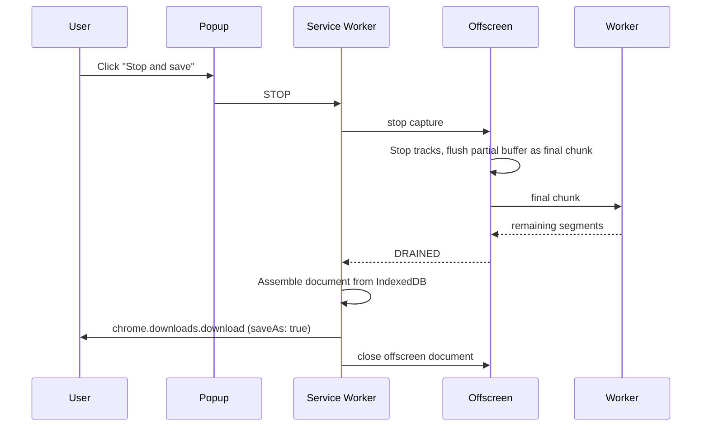

# Meet Transcript Notes — Chrome Extension Plan

A Manifest V3 Chrome extension that captures the audio of a Google Meet tab, transcribes it **locally in the browser** with [`openai/whisper-large-v3-turbo`](https://huggingface.co/openai/whisper-large-v3-turbo), and lets the user download the transcript notes by pressing **"Stop and save"**.

---

## 1. Goals & Non-Goals

### Goals
- Capture **both** the Google Meet tab audio (remote participants) **and** the user's microphone, always together. This is fixed behavior with no option to turn it off.
- Download the Whisper model **once** during setup, cache it, and reuse it offline afterward.
- Language selector (auto-detect plus an explicit list of Whisper languages).
- Live transcript preview while recording.
- A **"Stop and save"** button that ends the capture and downloads the transcript as a **Markdown (`.md`)** file.
- 100% on-device processing. No audio or text leaves the machine.

### Non-Goals (v1)
- Speaker diarization based on the audio itself. (Meet's DOM may optionally give speaker hints, see §9.)
- Cloud transcription, AI summaries, or action items. The output is a **timestamped transcript only**.
- Transcribing after the meeting (record now, process later). Transcription is **live only**.
- A setting to turn off the tab or microphone source.
- Platforms other than Google Meet. (The architecture keeps this possible.)

---

## 2. Key Technical Decisions

| Concern | Decision | Rationale |
|---|---|---|
| Extension platform | Chrome **Manifest V3** | Required for new Chrome Web Store extensions. |
| Tab audio capture | `chrome.tabCapture.getMediaStreamId()`, then `getUserMedia({ chromeMediaSource: 'tab' })` in an **offscreen document** | The MV3 service worker has no DOM or media APIs, so the offscreen document holds the `MediaStream`. |
| Inference runtime | **Transformers.js v3** (`@huggingface/transformers`) with ONNX Runtime Web | Runs Whisper in the browser. |
| Model weights | `onnx-community/whisper-large-v3-turbo` (an ONNX export of `openai/whisper-large-v3-turbo`) | The original PyTorch/safetensors weights can't run in the browser, so we use the ONNX conversion. |
| Execution backend | **WebGPU** first, **WASM** fallback | WebGPU is needed for near-real-time speed with large-v3-turbo. WASM works but will lag far behind live audio. |
| Quantization | Encoder `fp16`, decoder `q4` (configurable) | Balances size (~1 GB total), speed, and accuracy. |
| Model caching | Cache Storage via Transformers.js `env.useBrowserCache`, plus the `unlimitedStorage` permission | One-time download, persistent across sessions. |
| Inference thread | Dedicated **Web Worker** started by the offscreen document | Keeps audio capture responsive during heavy inference. |
| UI | Popup for controls; **Options/Setup page** for onboarding and model download | |
| Session persistence | IndexedDB | Recovers the transcript if the browser or extension crashes. |
| Build | Vite + `@crxjs/vite-plugin` (or plain Vite multi-entry), TypeScript | |

> **Model facts:** whisper-large-v3-turbo has ~809M parameters (32 encoder layers, 4 decoder layers) and supports 99 languages. It was fine-tuned for **transcription only**, so translation (`task: "translate"`) quality is poor. v1 offers transcription only.

---

## 3. Architecture



### Components

1. **Service Worker (`background.ts`)**
   - Single source of truth for recording state: `idle | starting | recording | stopping | error`.
   - Creates and closes the offscreen document.
   - Calls `chrome.tabCapture.getMediaStreamId({ targetTabId })`. This must happen in response to a user gesture, which the popup click provides.
   - Saves segments to IndexedDB and relays them to the popup.
   - Builds the final file and starts the download through `chrome.downloads.download`.
   - Updates the action badge: red "REC" while recording, "…" while finishing.

2. **Offscreen Document (`offscreen.html/ts`)**
   - Created with reasons `USER_MEDIA` (and `WORKERS`).
   - Opens the tab stream:
     ```ts
     navigator.mediaDevices.getUserMedia({
       audio: { mandatory: { chromeMediaSource: 'tab', chromeMediaSourceId: streamId } }
     });
     ```
   - **Routes audio back to the speakers** (`source.connect(ctx.destination)`). Tab capture mutes the tab by default, so without this the user would stop hearing the meeting.
   - Resamples to **16 kHz mono** with an `AudioWorklet` and buffers Float32 PCM.
   - Splits audio into chunks (§5) and posts them to the inference worker.
   - Always mixes in the **user's microphone** (§8). The mic is never played back to the speakers, to avoid echo.

3. **Inference Worker (`whisper.worker.ts`)**
   - Loads the `automatic-speech-recognition` pipeline once and keeps it warm.
   - Gets `{ audio: Float32Array, language, chunkStartTime }` and returns timestamped segments.
   - Reports load and download progress events.

4. **Popup (`popup.html/tsx`)**
   - Shows model status (Not downloaded / Downloading xx% / Ready).
   - **Language selector**, pre-filled with the saved default.
   - **Start transcription** button, enabled only when the active tab matches `https://meet.google.com/*`, the model is ready, **and** microphone permission has been granted. If permission is missing, the popup shows a "Grant microphone access" link to the setup page.
   - Live transcript preview (last N segments, auto-scroll) and elapsed timer.
   - **"Stop and save"** button.
   - "Stop and save" always downloads a `.md` file. There's no format selector.

5. **Setup / Options page (`options.html/tsx`)**
   - Opens automatically on `chrome.runtime.onInstalled` (`reason === 'install'`).
   - Checks capabilities: WebGPU availability (`navigator.gpu.requestAdapter()`), `shader-f16` support, and storage quota (`navigator.storage.estimate()`).
   - **Download model** button with a progress bar, total size, and resume on failure.
   - **Grant microphone access** step (required, §8). Setup isn't complete until this is done.
   - Settings: default language, quantization preset, filename template, timestamp style.
   - "Delete model" and "Re-download" actions.

6. **Content Script (`meet.content.ts`), optional**
   - Runs on `https://meet.google.com/*`.
   - Detects when the meeting starts or ends, and reads the meeting title or code for the filename.
   - Optional: watches active-speaker indicators to label segments (best-effort, §9).

---

## 4. One-Time Model Setup Flow



- The `progress_callback` from Transformers.js combines per-file progress into a single bar.
- `chrome.storage.local` saves `{ modelId, dtype, revision, downloadedAt }`.
- Later loads use `env.allowRemoteModels = false` once the cache is confirmed, so the extension works offline.
- **Pin a model revision** (a commit hash) so files don't change without notice.
- The model is always fetched from the Hugging Face Hub. There is **no self-hosted mirror**. If the download fails (network error, blocked domain), the setup page shows the error with a **Retry** button that resumes from the files already cached. Recording stays disabled until the model is fully cached.

> [!NOTE]
> Chrome Web Store packages are limited in size, and shipping ~1 GB of weights inside the package isn't practical. That's why the model is downloaded at setup, as requested.

---

## 5. Audio Pipeline & Chunking Strategy

Whisper works on **30-second windows**. Tab audio arrives as a continuous stream.

1. **Capture:** a `MediaStream` from the tab goes into an `AudioContext` at the device sample rate (usually 48 kHz).
2. **AudioWorklet:** downmixes to mono, resamples to 16 kHz, and posts 100 ms frames to the offscreen main thread.
3. **VAD (voice activity detection):** an energy/RMS threshold for v1, with Silero VAD (ONNX, ~2 MB) as an upgrade. Two uses:
   - Skip silent stretches, which saves GPU time and avoids Whisper hallucinations like "Thank you." on silence.
   - Pick **chunk boundaries at pauses** instead of cutting mid-word.
4. **Chunk policy:**
   - Target chunk length is 10 to 25 s, cut at the nearest pause of 300 ms or more after 10 s, with a hard cap at 28 s.
   - Keep ~0.5 s of overlap with the previous chunk. Remove duplicate words at the boundary using timestamps.
5. **Queue:** a FIFO queue between offscreen and the worker. If the queue grows past a threshold, the device can't keep up: show a "lagging" indicator, and on Stop, drain the queue before saving.
6. **Timestamps:** each segment's absolute time = `chunkStartTime + segment.timestamp`, measured from the session start.

### Inference call
```ts
const result = await transcriber(audio, {
  language: lang === 'auto' ? null : lang, // e.g. 'english', 'portuguese'
  task: 'transcribe',
  return_timestamps: true,
  // chunk_length_s / stride_length_s not needed: we chunk ourselves
});
```

---

## 6. Language Selector

- **Auto-detect** is the default. Whisper detects the language from the first 30 s window. Lock the detected language for the rest of the session to avoid flip-flopping, and show it in the UI.
- An explicit list of Whisper's 99 languages, shown by native name and searchable, with recent and favorite languages pinned at the top.
- The language can be changed **mid-session**. The change applies from the next chunk.
- Store the default in `chrome.storage.sync`.
- Data source: a static `languages.ts` map (`code → { english name, native name, whisper token }`) taken from the Whisper tokenizer.

---

## 7. "Stop and save" Flow



- During draining, the popup shows "Finishing transcription… (N chunks left)".
- If the popup closes during recording or stopping, work continues because state lives in the service worker and offscreen document. Reopening the popup restores the view.
- The download uses a Blob URL created in the offscreen document (service workers can't call `URL.createObjectURL`), or a `data:` URL for small files.
- Filename template default: `Meet - {meetingTitle} - {YYYY-MM-DD HHmm}.md`.

### Output format (Markdown only)
```markdown
# Meeting Transcript — Weekly Sync
- **Date:** 2026-11-11 10:00–10:42 (42 min)
- **Meeting:** meet.google.com/abc-defg-hij
- **Language:** English (auto-detected)
- **Model:** whisper-large-v3-turbo (local, WebGPU)

> Automatically generated transcript — may contain errors.

---

**[00:00:04]** Okay, let's get started. First item is the release timeline…

**[00:00:31]** *(Speaker: Maria)* I think we can ship on Friday if…
```
Markdown is the only export format.

---

## 8. Audio Sources: Meeting + Microphone (Always Both)

Tab capture only includes **remote participants**. Meet doesn't play your own microphone back into the tab. To get the full conversation, the extension **always** captures both sources. There's no setting to turn either one off.

- **Permission:** microphone permission has to be granted from a visible extension page (the setup page), because offscreen documents can't show permission prompts. After it's granted once, the offscreen document can call `getUserMedia({ audio: { echoCancellation: true, noiseSuppression: true } })` without prompting.
- **Start is blocked** until both the tab stream and the mic stream open. If either fails (permission revoked, no input device), recording doesn't start and the popup shows a clear error with a link to fix it.
- **Mixing:** both sources go through `GainNode`s and are summed into the single 16 kHz mono stream that goes to Whisper. Only the tab source is connected to `ctx.destination`. The mic is never played back, to avoid echo.
- **Echo/double-capture:** keep `echoCancellation: true` on the mic so remote audio from the speakers isn't transcribed twice. Headphones give the best results, and the setup page should say so.
- **Mic disconnect during recording:** if the mic track ends mid-session (`track.onended`), pause and show an error. Don't silently continue with tab audio only.
- **Possible later:** keep the sources as separate channels to label segments "You" vs. "Others".

---

## 9. Speaker Labels (Optional, Best-Effort)

- The content script watches Meet's active-speaker UI (the highlighted tile or speaking indicator) and sends `{ name, startTs, endTs }` events.
- The service worker matches each segment to the speaker with the largest time overlap.
- **Fragile:** Meet's DOM changes often, so selectors live in one config file and the feature fails silently. It's turned off by default in v1.

---

## 10. Permissions & Manifest

```json
{
  "manifest_version": 3,
  "name": "Meet Transcript Notes",
  "version": "0.1.0",
  "minimum_chrome_version": "116",
  "permissions": ["tabCapture", "offscreen", "storage", "unlimitedStorage", "downloads"],
  "host_permissions": [
    "https://meet.google.com/*",
    "https://huggingface.co/*",
    "https://*.huggingface.co/*",
    "https://*.hf.co/*"
  ],
  "background": { "service_worker": "background.js", "type": "module" },
  "action": { "default_popup": "popup.html" },
  "options_page": "options.html",
  "content_scripts": [{ "matches": ["https://meet.google.com/*"], "js": ["meet.content.js"] }],
  "content_security_policy": {
    "extension_pages": "script-src 'self' 'wasm-unsafe-eval'; object-src 'self'"
  },
  "web_accessible_resources": []
}
```
### Why each permission is needed

| Permission | Purpose |
|---|---|
| `tabCapture` | Captures the Meet tab's audio (`chrome.tabCapture.getMediaStreamId`). |
| `offscreen` | Creates the offscreen document that holds the audio streams, the AudioContext and the Whisper worker. |
| `storage` | Settings (default language, filename template) and model info. |
| `unlimitedStorage` | Keeps the ~1 GB of model files and the IndexedDB session data from being cleared when storage runs low. |
| `downloads` | Saves the `.md` transcript on "Stop and save" (with a `saveAs` dialog). |
| Host `meet.google.com` | Check that the active tab is a Meet call, and run the content script (meeting title). |
| Host `huggingface.co`, `*.huggingface.co`, `*.hf.co` | The one-time model download, including Hugging Face's redirects to its CDN domains. |
| Microphone (no manifest entry) | Chrome's normal "Allow microphone?" prompt, shown once on the setup page via `getUserMedia`. After that, the extension can use the mic without asking again. |

**Not requested:** `activeTab` (not needed, because the user's click on the extension plus the Meet host permission is enough for `tabCapture`), `tabs`, `scripting`, `<all_urls>`, `webRequest`, `identity`.

- `'wasm-unsafe-eval'` is required for ONNX Runtime Web (WASM).
- ONNX Runtime `.wasm` files are **bundled locally** (set `env.backends.onnx.wasm.wasmPaths` to an extension URL), because MV3 forbids remotely hosted code. Model *weights* count as data, so fetching them remotely is allowed.
- `minimum_chrome_version` 116 or higher for `getMediaStreamId` from the service worker plus WebGPU.

---

## 11. Project Structure

```
meet-transcript-notes/
├── PLAN.md
├── package.json
├── vite.config.ts
├── tsconfig.json
├── public/
│   ├── icons/
│   └── ort/                    # bundled onnxruntime-web .wasm files
├── src/
│   ├── manifest.json
│   ├── background/
│   │   ├── index.ts            # service worker, state machine
│   │   ├── offscreen-manager.ts
│   │   └── export.ts           # Markdown builder
│   ├── offscreen/
│   │   ├── offscreen.html
│   │   ├── offscreen.ts        # capture, playback passthrough, mixing
│   │   ├── resampler.worklet.ts
│   │   ├── vad.ts
│   │   └── chunker.ts
│   ├── worker/
│   │   └── whisper.worker.ts   # Transformers.js pipeline
│   ├── popup/
│   │   ├── popup.html
│   │   └── Popup.tsx
│   ├── options/
│   │   ├── options.html
│   │   └── Options.tsx         # setup, model download, mic permission
│   ├── content/
│   │   └── meet.content.ts
│   └── shared/
│       ├── messages.ts         # typed message contracts
│       ├── languages.ts
│       ├── model-manifest.json # pinned revision + SHA-256 per model file
│       ├── integrity.ts        # streaming hash checks
│       ├── storage.ts          # chrome.storage + IndexedDB helpers
│       └── types.ts
├── scripts/
│   └── gen-model-manifest.ts   # builds model-manifest.json from the HF Hub API
└── tests/
```

---

## 12. Implementation Milestones

| # | Milestone | Deliverables | Done when |
|---|---|---|---|
| **M0** | Scaffold | Vite + TS + MV3 build, popup/options/offscreen shells, typed messaging | Extension loads unpacked with no errors |
| **M1** | Audio capture (tab + mic) | Start/stop capture on a Meet tab, tab audio passthrough, mic capture, mixing, 16 kHz resampler, debug WAV dump | A clean 16 kHz WAV containing both remote participants and the user's voice can be downloaded, and the user still hears the call |
| **M2** | Model setup | Setup page, download with progress, caching, warm-up, mic permission step, **SHA-256 checks against the manifest**, **resource check + benchmark** | Model loads offline after one download, reload doesn't re-download, mic permission persists, a tampered file is detected, and setup shows resource warnings |
| **M3** | Transcription | Worker pipeline, chunker + basic VAD, live segments in popup | A 10-min call is transcribed live with timestamps |
| **M4** | Language selector | Auto-detect + list, persistence, mid-session change | Non-English meeting transcribed correctly with explicit and auto modes |
| **M5** | Stop and save | Queue draining, Markdown export, filename template, IndexedDB crash recovery | Clicking "Stop and save" always produces a complete file |
| **M6** | Polish | Badge, lag indicator, error states (mic/tab failures, mic disconnect), delete-model, **resource release after Stop** | End-to-end on a real call with both sides captured, and memory returns to baseline after Stop |
| **M7** | Hardening | **GPU device-lost recovery**, WASM fallback path, long-session tests (2h), memory profiling, dependency audit, store listing, privacy policy | Survives a forced GPU reset without losing chunks, no memory growth over 2h, and Web Store submission ready |
| *Later* | Extras | Speaker hints, "You" vs. "Others" labels, smaller-model option (`whisper-base`/`small`) for weak GPUs | |

---

## 13. Risks & Mitigations

| Risk | Impact | Mitigation |
|---|---|---|
| No WebGPU / weak GPU | Live transcription falls behind real time | Capability check at setup with a clear warning. Show the lag indicator while recording, and drain the queue on Stop. Offer a smaller model fallback later (e.g. `whisper-small`, `whisper-base`). There's no post-meeting mode, since transcription is live only. |
| ~1 GB download | Slow onboarding, storage pressure | Clear size warning, resumable download, `unlimitedStorage`, delete option. |
| Network failure / huggingface.co blocked | Model can't be downloaded | No self-hosted mirror (by decision). Show a clear error and a Retry that resumes from cached files. Recording stays disabled until the model is cached. |
| Tab muted after capture | User can't hear the meeting | Always connect the source to `AudioContext.destination`. Covered by an M1 test. |
| Own voice missing | Incomplete transcript | Mic is always captured and mixed (§8). Recording won't start without it. |
| Remote audio captured twice (speakers → mic) | Duplicated text | `echoCancellation` on the mic, a headphones recommendation, and removal of near-identical overlapping segments. |
| Whisper hallucinations on silence/music | Junk text | VAD gating, drop segments with low `avg_logprob` / high no-speech probability, remove repeated-phrase loops. |
| Service worker termination | Lost state | Active offscreen document plus regular messages keep it alive. State is mirrored to IndexedDB and restored on wake. |
| Meet DOM changes | Speaker labels break | Optional feature that fails silently, with selectors kept in one place. |
| Privacy / consent | Legal exposure | Fully local processing. Show a reminder to inform participants. No telemetry. Clear privacy policy. |
| Tampered or corrupted model files | Wrong or unsafe model loaded | Pinned revision, plus SHA-256 checks against a hash manifest shipped with the extension (§14.1). On mismatch, delete and re-download. |
| Compromised npm dependency | Malicious code inside the extension | Exact versions plus lockfile, `npm ci`, `npm audit` in CI, deliberate upgrades only (§14.2). |
| GPU device lost (driver reset, out of memory) | Transcription stops mid-meeting | Automatic recovery: reload the model and replay the queued chunks that weren't confirmed (§14.3). |
| GPU/RAM held between meetings | Slows other apps, drains battery | Release the model and close the offscreen document after "Stop and save" (§14.4). |
| Low-end hardware | Lag, swapping, overheating | Resource check plus a benchmark at setup, with a clear warning (§14.5). |

---

## 14. Security & Resource Safeguards

### Security overview
- **The model files are data, not code.** Only ONNX files (plus JSON config/tokenizer) are loaded. PyTorch `.bin`/pickle files, which can run hidden code, are never fetched.
- **Sandboxed execution.** Inference runs through WebGPU/WASM inside a Chrome web worker, with no access to the file system or the operating system.
- **No data leaves the device.** No telemetry and no network calls except the one-time model download from Hugging Face.
- **License:** the model is MIT-licensed.

### 14.1 Model file integrity (SHA-256 checks)
- At build time, a script (`scripts/gen-model-manifest.ts`) reads the **pinned revision** of `onnx-community/whisper-large-v3-turbo` and records each file's path, size and SHA-256. It uses the LFS `oid` from the Hugging Face Hub API for the large files. The output is `src/shared/model-manifest.json`, bundled with the extension.
- After download, and before the model is marked "ready", each cached file is read back from Cache Storage and hashed.
  - `crypto.subtle.digest` can't hash in pieces, and the largest files are close to 1 GB, so large files use a streaming SHA-256 (e.g. `hash-wasm`) to avoid loading a whole file into memory.
- **On mismatch:** delete that file from the cache, show "Model file failed verification", and offer Retry. Recording stays disabled.
- Run a cheap size-only check on every model load, and a full hash check after download and from a "Verify model" button in Options.
- Model URLs always include the pinned revision (`/resolve/<commit-sha>/...`), never `main`.

### 14.2 Dependency supply chain
- Use exact versions for `@huggingface/transformers` and `onnxruntime-web` (no `^`/`~`), commit `package-lock.json`, and install with `npm ci`.
- Run `npm audit` and a license check in CI. Upgrade dependencies deliberately, with a changelog review.
- ONNX Runtime `.wasm` files are bundled into the extension package, so no code is fetched remotely (MV3 forbids it anyway).
- The CSP stays at `script-src 'self' 'wasm-unsafe-eval'`, with no remote script sources.

### 14.3 GPU "device lost" recovery
- Listen for `GPUDevice.lost` and for inference errors from ONNX Runtime's WebGPU backend inside the worker.
- The offscreen document keeps each audio chunk until the worker **confirms** it, so no chunk is lost when the GPU resets.
- Recovery steps: dispose of the pipeline, end the worker, start a new worker, reload the model from cache (no network), then resend the unconfirmed chunks in order.
- The popup shows "Recovering transcription engine…" in the meantime, and audio capture keeps running.
- **Retry limit:** 3 recoveries within 10 minutes. After that, stop inference, keep the transcript so far in IndexedDB, and show an error. "Stop and save" still downloads what was transcribed.
- Optional fallback: after repeated GPU failures, offer to continue on the WASM backend (slow, but more stable).

### 14.4 Releasing resources after "Stop and save"
- After the file download starts: call `pipeline.dispose()` in the worker to free GPU buffers, end the worker, then close the offscreen document (`chrome.offscreen.closeDocument()`).
- No model is kept loaded between meetings, so GPU memory and RAM go back to normal when idle.
- **Tradeoff:** each Start reloads the model from cache and recompiles the WebGPU shaders, which takes a few seconds. The popup shows a "Loading model…" state, and the Start button stays disabled until loading finishes.
- The model files stay **on disk** (Cache Storage) until the user clicks "Delete model" or uninstalls the extension.

### 14.5 Resource check & warning at setup
WebGPU doesn't report how much GPU memory a machine has, so the check combines several signals:

| Check | Source | Warning threshold |
|---|---|---|
| WebGPU available | `navigator.gpu.requestAdapter()` | Missing: show a strong warning that live transcription will fall far behind on WASM |
| fp16 support | `adapter.features.has('shader-f16')` | Missing: fall back to an fp32 encoder (bigger, slower) and warn |
| GPU buffer limits | `adapter.limits.maxBufferSize`, `maxStorageBufferBindingSize` | Below what the model's largest tensors need |
| System RAM | `navigator.deviceMemory` (capped at 8) | Less than 8 GB |
| Free disk space | `navigator.storage.estimate()` | Less than ~2 GB free |
| **Real-time benchmark** | Transcribe a bundled 10 s speech sample during warm-up | Real-time factor > 0.8 (likely to lag in live meetings) |

- Results appear on the setup page as ✅ / ⚠️ / ❌, with plain-language explanations. Warnings don't block setup, but a missing model or missing mic permission does.
- A one-line summary (e.g. "This machine may struggle with live transcription") is saved and shown in the popup.
- Laptop tip on the setup page: plug in power during long meetings. Continuous GPU use increases heat and battery drain, and the OS throttles the GPU when it gets hot (this can't damage the hardware).

### Accuracy note
Whisper can make up text during silence or music, or loop on a repeated phrase. Voice detection and filtering (§5, §13) reduce this. The Markdown header includes the note *"Automatically generated transcript — may contain errors."*

---

## 15. Testing Strategy

- **Unit:** chunker boundary logic, overlap de-duplication, exporters (Markdown formatting), language map, hash manifest checks (match, mismatch, missing file).
- **Integration:** feed recorded WAV fixtures (multiple languages, silence, music) through the offscreen→worker pipeline in a headless Chrome run with Puppeteer and `--enable-unsafe-webgpu`.
- **Integrity:** corrupt a cached model file, then confirm that verification fails, the file is deleted, and Retry downloads it again.
- **Device lost:** force a GPU reset with `device.destroy()` mid-session, then check that recovery succeeds, no chunks are lost, and the retry limit is respected.
- **Resource release:** after "Stop and save", confirm in `chrome://gpu` / Task Manager that GPU and JS memory return to baseline and the offscreen document is closed.
- **Manual E2E:** real Meet calls of 5 min, 30 min, and 2 h. Check audio passthrough, accuracy, drain-on-stop, and file contents.
- **Performance metrics:** real-time factor (RTF = processing time / audio time, target < 0.5 on WebGPU), peak GPU/JS memory, queue depth over time.

---

## 16. Decisions & Open Questions

### Decided
- **Output:** timestamped transcript only. No AI summary or action items.
- **Audio sources:** meeting tab audio **and** user microphone, always both, with no option to change it.
- **Mode:** live transcription only. No post-meeting transcription mode.
- **Export format:** Markdown (`.md`) only.
- **Model hosting:** always downloaded from the Hugging Face Hub. No self-hosted mirror, and download failures are handled with an error message and Retry.
- **Permissions:** `tabCapture`, `offscreen`, `storage`, `unlimitedStorage`, `downloads`, plus host access to Meet and Hugging Face. No `activeTab`.
- **Safeguards:** SHA-256 model checks, locked dependency versions, GPU device-lost recovery, model released after each meeting, and a resource check at setup (§14).

### Open
- None at this time.

